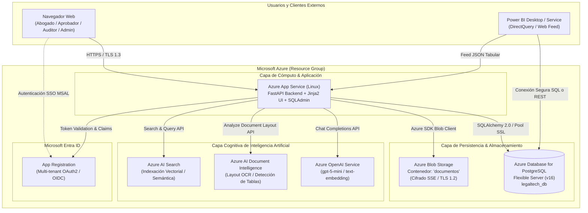
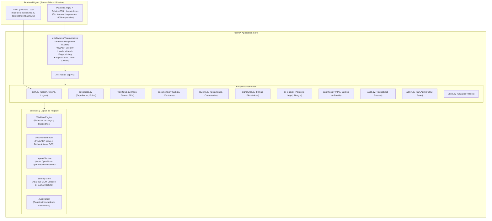
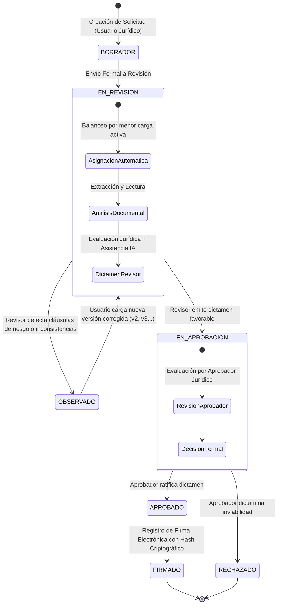
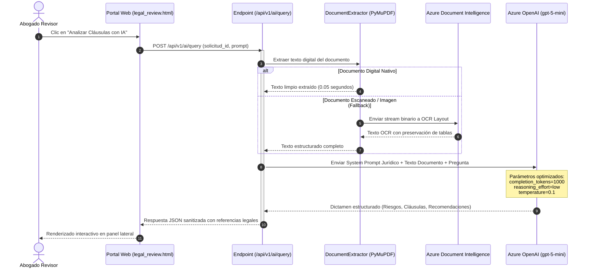
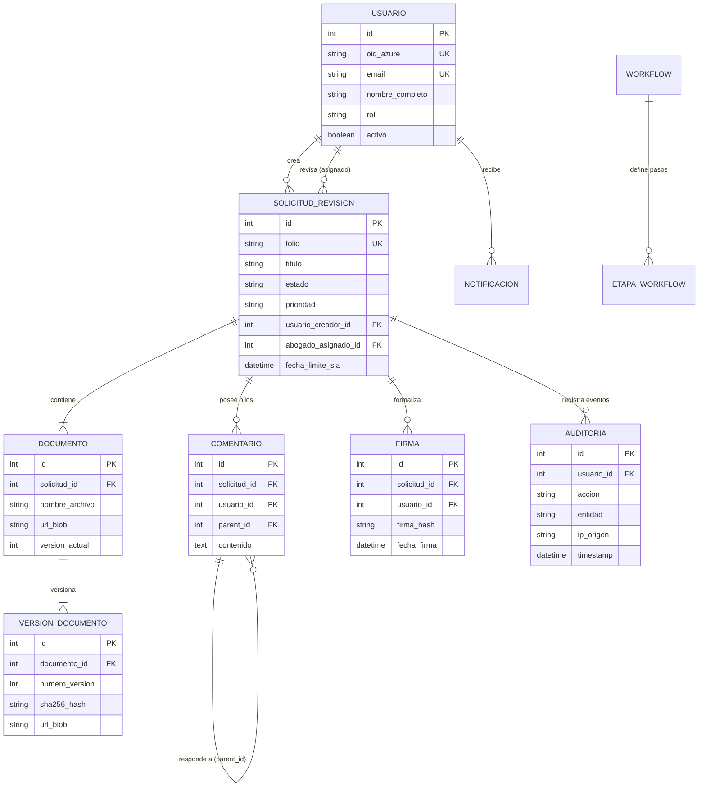

# 🏛️ Arquitectura del Sistema — LegalprojectIA
## Plataforma de Workflow para Revisión Jurídica con Inteligencia Artificial (SaaS)

**Organización Patrocinadora:** PluriOne S.A. de C.V. (Develop Talent & Technology)  
**Institución Académica:** Instituto Tecnológico Superior de Atlixco (ITSA) — Residencia Profesional  
**Estado del Proyecto:** Etapa Terminal / Listo para Producción (Release Candidate)  
**URL de Producción:** https://legaltech-api-LegalprojectIA-1134.azurewebsites.net  

---

## 📑 Tabla de Contenidos
1. [Visión General](#-1-visión-general)
2. [Diagrama de Arquitectura en la Nube (Microsoft Azure)](#-2-diagrama-de-arquitectura-en-la-nube-microsoft-azure)
3. [Diagrama C4: Contenedores y Flujo de Información](#-3-diagrama-c4-contenedores-y-flujo-de-información)
4. [Máquina de Estados del Workflow BPM](#-4-máquina-de-estados-del-workflow-bpm)
5. [Orquestación de Inteligencia Artificial y Extracción Documental](#-5-orquestación-de-inteligencia-artificial-y-extracción-documental)
6. [Modelo de Seguridad, Identidad y RBAC](#-6-modelo-de-seguridad-identidad-y-rbac)
7. [Esquema de Base de Datos y Persistencia](#-7-esquema-de-base-de-datos-y-persistencia)
8. [Integración Analítica y Power BI](#-8-integración-analítica-y-power-bi)

---

## 🌐 1. Visión General

**LegalprojectIA** es una plataforma corporativa desarrollada en arquitectura de tres capas modulares diseñada para automatizar, agilizar y auditar el ciclo de vida completo de documentos legales (contratos mercantiles, convenios de confidencialidad NDA, adendas, poderes notariales y políticas internas).

La plataforma combina:
- **Gestor BPM (Business Process Management):** Asignación automática por carga activa de trabajo, transiciones estrictas de estado y trazabilidad legal.
- **Inteligencia Artificial Especializada:** Azure OpenAI (`gpt-5-mini` / `gpt-4o-mini`) con prompts jurídicos densos y OCR inteligente mediante Azure AI Document Intelligence y PyMuPDF.
- **Seguridad Grado Corporativo:** Autenticación federada mediante Microsoft Entra ID (SSO), control de acceso basado en roles (RBAC), firmas digitales con hash inmutable SHA-256 y cifrado en reposo AES-256-GCM.
- **Inteligencia de Negocio:** Tableros analíticos en Microsoft Power BI conectados a vistas SQL optimizadas y endpoints REST seguros.

---

## ☁️ 2. Diagrama de Arquitectura en la Nube (Microsoft Azure)

El sistema opera completamente sobre servicios gestionados (PaaS) de Microsoft Azure en esquema *Turnkey Zero-Touch*:

---

## 🧱 3. Diagrama C4: Contenedores y Flujo de Información

La siguiente vista de contenedores detalla la organización interna de la aplicación:

---

## 🔄 4. Máquina de Estados del Workflow BPM

Cada solicitud de revisión jurídica transita por un ciclo de vida estrictamente regulado por el motor `WorkflowEngine` (`app/services/workflow_engine.py`):

### Reglas de Negocio en las Transiciones:
- **RN-001 (Balanceo Equitativo):** Al ingresar al estado `EN_REVISION`, el sistema calcula el número de solicitudes activas de cada abogado con rol `REVISOR_JURIDICO` y asigna automáticamente la solicitud al que tenga la menor carga de trabajo.
- **RN-004 (Inmutabilidad de Versiones):** Cada ajuste tras una observación no sobrescribe el archivo anterior; crea un nuevo registro inmutable en `VersionDocumento` con su propio hash SHA-256 y marca el anterior como histórico.
- **RN-008 (Supervisión Humana Obligatoria):** La Inteligencia Artificial genera dictámenes preliminares y semaforización de riesgos, pero únicamente un usuario humano con rol `REVISOR_JURIDICO` o `APROBADOR_JURIDICO` puede validar y cambiar el estado formal de la solicitud.
- **RN-010 (Trazabilidad Mandatoria):** Cada transición genera automáticamente una entrada en la tabla `Auditoria` registrando usuario, rol, IP de origen, fecha/hora y detalle del cambio.

---

## 🧠 5. Orquestación de Inteligencia Artificial y Extracción Documental

La plataforma implementa un pipeline híbrido de procesamiento de lenguaje natural y visión computacional:

---

## 🔐 6. Modelo de Seguridad, Identidad y RBAC

### 1. Autenticación Federada con Microsoft Entra ID
- Implementación de Single Sign-On (SSO) mediante MSAL (Microsoft Authentication Library).
- Soporte para esquemas **Multi-Tenant** (cualquier cuenta educativa o corporativa de Microsoft) y restricción opcional **Single-Tenant**.
- Auto-aprovisionamiento seguro de usuarios (*Just-In-Time Provisioning*) al iniciar sesión por primera vez.

### 2. Matriz de Control de Acceso Basado en Roles (RBAC)
La aplicación cuenta con 4 roles formalmente separados a nivel de endpoint mediante el decorador `@requiere_roles(...)`:

| Recurso / Módulo | Revisor Jurídico | Aprobador Jurídico | Administrador | Auditor |
| :--- | :---: | :---: | :---: | :---: |
| **Dashboard y Métricas** | ✅ | ✅ | ✅ | ✅ |
| **Mis Tareas (Inbox Personal)** | ✅ | ✅ | ✅ | ❌ |
| **Crear Nueva Solicitud** | ✅ | ✅ | ✅ | ❌ |
| **Revisar y Emitir Dictamen** | ✅ | ❌ | ✅ | ❌ |
| **Comentar en Hilos** | ✅ | ✅ | ✅ | ❌ |
| **Aprobar / Rechazar Solicitud** | ❌ | ✅ | ✅ | ❌ |
| **Registrar Firma Electrónica** | ❌ | ✅ | ✅ | ❌ |
| **Historial de Versiones** | ✅ | ✅ | ✅ | ❌ |
| **Bitácora de Auditoría Forense** | ❌ | ❌ | ✅ | ✅ |
| **Gestión de Usuarios y Roles** | ❌ | ❌ | ✅ | ❌ |
| **Panel SQLAdmin (ORM Directo)** | ❌ | ❌ | ✅ | ❌ |
| **Reportes y Feed Power BI** | ❌ | ❌ | ✅ | ✅ |

### 3. Cifrado Criptográfico
- **Cifrado en Reposo (AES-256-GCM):** Los campos clasificados como confidenciales en la base de datos se cifran utilizando una clave de 256 bits y un vector de inicialización único (nonce de 12 bytes) por cada registro.
- **Sellado e Integridad (SHA-256):** Toda versión de contrato genera un hash criptográfico de 64 caracteres hexadecimales para garantizar la imposibilidad de repudio y la detección de cualquier alteración en el archivo.

---

## 🗄️ 7. Esquema de Base de Datos y Persistencia

El almacenamiento relacional reside en **PostgreSQL 16** gestionado mediante **SQLAlchemy 2.0** y migraciones controladas por **Alembic**:

---

## 📊 8. Integración Analítica y Power BI

La plataforma expone dos mecanismos para el consumo de datos ejecutivos:

1. **Vistas SQL Pre-optimizadas:**
   - `vw_powerbi_solicitudes_kpi`: Métricas de duración, cumplimiento de SLA, estado y tiempos de ciclo.
   - `vw_powerbi_cuellos_botella`: Densidad de trabajo por abogado revisor y detección de retrasos.
   - `vw_powerbi_trazabilidad`: Resumen cronológico de eventos para auditoría de cumplimiento.
2. **Endpoint REST API Segura (`/api/v1/analytics/powerbi-feed`):**
   - Retorna un payload JSON tabular aplanado para su consumo en Power BI Service sin requerir abrir el puerto 5432 de la base de datos a internet, protegido por `X-API-KEY` o token Bearer Entra ID.
