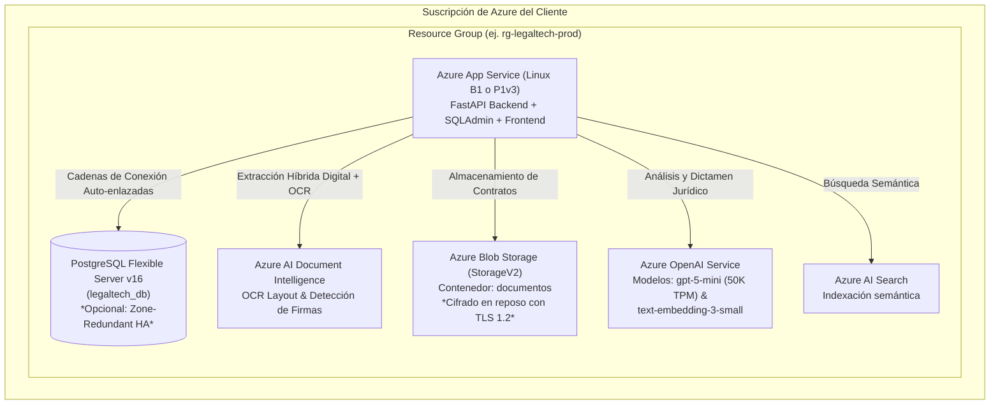

# 📦 Guía de Entrega y Despliegue en Azure (Click-to-Go)
## Plataforma de Workflow para Revisión Jurídica con Inteligencia Artificial (PluriOne LegalTech)

Esta guía está diseñada para el **equipo de TI / Cloud Operations del cliente**, proporcionando un procedimiento de despliegue automatizado, seguro y sin fricción (*zero-touch deployment*) en su propia suscripción de Microsoft Azure.

---

## 🏛️ 1. Arquitectura de la Solución Aprovisionada

Todo el ecosistema se despliega dentro de un único Resource Group en la suscripción del cliente y se interconecta de forma automática:



---

## ⚡ 2. Métodos de Despliegue "Click-to-Go"

El cliente puede elegir cualquiera de los dos métodos según su preferencia:

### Método A: Despliegue Visual con Botón "Deploy to Azure" (Recomendado - 1 Clic)

Haciendo clic en el siguiente botón oficial de Microsoft, el navegador abrirá el Portal de Azure directamente en el formulario visual de la plantilla:

[](https://portal.azure.com/#create/Microsoft.Template/uri/https%3A%2F%2Fraw.githubusercontent.com%2FKarlaAlexaBaltazarCorona-bit%2FG19X-ITSA-KABC-977-ACADEMIC%2Fmain%2Finfra%2Fazuredeploy.json)

**Pasos en el Portal:**
1. Seleccionar la **Suscripción** de Azure y el **Resource Group** (o crear uno nuevo, ej. `rg-legaltech-prod`).
2. Elegir la **Región** (ej. `eastus`, `mexicocentral`).
3. Seleccionar el **Perfil de Infraestructura (`environmentType`)**:
   - `Standard`: Balanceado en costos, ideal para operaciones habituales de medianos despachos (App Service B1, Postgres B1ms, OpenAI a 50K TPM, Storage LRS).
   - `Enterprise_HA`: Máxima resiliencia y redundancia corporativa (App Service P1v3 con auto-scaling, PostgreSQL Flexible Server con **Alta Disponibilidad Multizona Zone-Redundant**, Storage ZRS y Azure OpenAI con alta capacidad).
4. Ingresar la **Contraseña Maestra para PostgreSQL** (`dbAdminPassword`).
5. Presionar **"Revisar y Crear"** (*Review + Create*).
6. En aproximadamente **4 minutos**, Azure aprovisionará e interconectará todos los servicios sin intervención manual.

---

### Método B: Despliegue por Línea de Comandos (Azure CLI o Cloud Shell)

Para equipos de DevOps que prefieran la consola, pueden abrir [Azure Cloud Shell](https://shell.azure.com) (o su terminal local) y ejecutar:

#### En Linux / macOS / Azure Cloud Shell (Bash):
```bash
# 1. Clonar el repositorio
git clone https://github.com/KarlaAlexaBaltazarCorona-bit/G19X-ITSA-KABC-977-ACADEMIC.git
cd G19X-ITSA-KABC-977-ACADEMIC

# 2. Ejecutar el script automatizado
chmod +x scripts/deploy_client_infra.sh
./scripts/deploy_client_infra.sh "rg-legaltech-prod" "eastus" "Standard"
```

#### En Windows (PowerShell):
```powershell
# 1. Clonar el repositorio
git clone https://github.com/KarlaAlexaBaltazarCorona-bit/G19X-ITSA-KABC-977-ACADEMIC.git
cd G19X-ITSA-KABC-977-ACADEMIC

# 2. Ejecutar el script automatizado
.\scripts\deploy_client_infra.ps1 -ResourceGroupName "rg-legaltech-prod" -Location "eastus" -EnvironmentType "Standard"
```

---

## 🔒 3. Cero Talacha Manual: Auto-Enlace de Credenciales y Secretos

La plantilla ARM / Bicep utiliza funciones nativas de Azure Resource Manager (`reference`, `listKeys`, `listAdminKeys`) para inyectar automáticamente en las variables de entorno de Azure App Service:

| Variable de Entorno | Origen del Valor Aprovisionado Automáticamente |
| :--- | :--- |
| `POSTGRES_URL` | Enlace seguro autogenerado hacia el servidor PostgreSQL Flexible recién creado |
| `AZURE_OPENAI_ENDPOINT` | Endpoint privado del recurso Azure OpenAI creado |
| `AZURE_OPENAI_API_KEY` | Clave primaria (`Key 1`) extraída automáticamente de Azure OpenAI |
| `AZURE_DOCUMENT_INTELLIGENCE_ENDPOINT` | Endpoint del recurso Document Intelligence para OCR |
| `AZURE_DOCUMENT_INTELLIGENCE_KEY` | Clave primaria de Document Intelligence |
| `AZURE_STORAGE_CONNECTION_STRING` | Cadena de conexión cifrada del Storage Account para almacenamiento de expedientes |
| `AZURE_SEARCH_ENDPOINT` y `KEY` | Endpoint y clave de administración de Azure AI Search |
| `APP_ENCRYPTION_KEY` | Clave simétrica de 32 bytes autogenerada y derivada criptográficamente para cifrado en reposo |
| `RATE_LIMIT_PER_MINUTE` | Configurado a `2400` peticiones/minuto para soportar tráfico corporativo multi-abogado |

> **Nota para el equipo de seguridad del cliente:** Ninguna clave se almacena en texto plano en repositorios ni requiere ser escrita a mano por el operador; el aprovisionador de Azure las conecta internamente de servicio a servicio.

---

## ✅ 4. Verificación Post-Despliegue

Una vez concluido el despliegue:

1. **Prueba de Salud (Health Check):**
   Abre en el navegador la URL del App Service indicada al final del despliegue:
   ```
   https://app-legaltech-<uniqueSuffix>.azurewebsites.net/health
   ```
   Debe responder: `{"status": "healthy"}`.

2. **Panel de Base de Datos y Administración (SQLAdmin):**
   ```
   https://app-legaltech-<uniqueSuffix>.azurewebsites.net/admin
   ```
   Permite gestionar y visualizar usuarios, expedientes y revisiones directamente.

3. **Copilot Jurídico con Extracción Híbrida y Azure OCR:**
   El motor de IA y OCR operará de inmediato leyendo documentos PDF, Word o imágenes escaneadas con la cuota de tokens optimizada.

---

## 📖 5. Documentación y Recursos Relacionados

- [🧭 Centro de Documentación Oficial](INDEX.md)
- [📘 Manual de Usuario y Guía de Roles](MANUAL_USUARIO_Y_ROLES.md)
- [🏛️ Arquitectura del Sistema y Diagramas C4](ARQUITECTURA_SISTEMA.md)
- [🛡️ Guía de Seguridad Corporativa y DevSecOps](SEGURIDAD_Y_DEVSECOPS.md)
- [📊 Integración y Métricas con Power BI](../powerbi/README_POWERBI.md)

