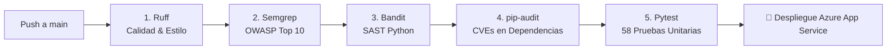

# 🛡️ Guía de Seguridad Corporativa y DevSecOps — LegalprojectIA

**Estándares de Referencia:** OWASP Top 10 (2021/2026), NIST SP 800-53, CIS Microsoft Azure Foundations Benchmark  
**Objetivo:** Garantizar la confidencialidad, integridad, disponibilidad y no repudio de la información jurídica corporativa gestionada en la plataforma SaaS.

---

## 📑 Tabla de Contenidos
1. [Principios Rectores de Seguridad](#-1-principios-rectores-de-seguridad)
2. [Mitigación Integral del OWASP Top 10](#-2-mitigación-integral-del-owasp-top-10)
3. [Criptografía Aplicada y Gestión de Llaves](#-3-criptografía-aplicada-y-gestión-de-llaves)
4. [Control de Identidad, SSO y RBAC](#-4-control-de-identidad-sso-y-rbac)
5. [Protección en Capa de Red y Aplicación (WAF & Headers)](#-5-protección-en-capa-de-red-y-aplicación-waf--headers)
6. [Pipeline Automatizado DevSecOps en CI/CD](#-6-pipeline-automatizado-devsecops-en-cicd)
7. [Pista de Auditoría Forense y Trazabilidad Inmutable](#-7-pista-de-auditoría-forense-y-trazabilidad-inmutable)
8. [Procedimiento de Respuesta a Incidentes y Monitoreo](#-8-procedimiento-de-respuesta-a-incidentes-y-monitoreo)

---

## 🏛️ 1. Principios Rectores de Seguridad

1. **Defensa en Profundidad (*Defense in Depth*):** Seguridad aplicada en capas concéntricas (Identidad Entra ID -> Rate Limiter y CSP -> API Gateway con API Key -> RBAC de endpoint -> Cifrado AES en Base de Datos -> Almacenamiento Cifrado en Azure Storage).
2. **Principio de Privilegio Mínimo (*PoLP*):** Cada usuario y servicio opera con los permisos estrictamente necesarios para su función.
3. **Cero Secretos en Código (*Zero Secrets Policy*):** Prohibición absoluta de credenciales fijas (*hardcoded*). Todas las variables provienen del entorno de Azure y `.env` excluido del control de versiones.
4. **Supervisión Humana Obligatoria en IA (*Human-in-the-Loop*):** Los algoritmos de Azure OpenAI son herramientas de asistencia; ninguna decisión legal o cambio de estado vinculante se ejecuta de forma autónoma por la IA.

---

## 🛡️ 2. Mitigación Integral del OWASP Top 10

| Identificador OWASP | Riesgo | Mecanismo de Mitigación Implementado en LegalprojectIA |
| :--- | :--- | :--- |
| **A01:2021 — Broken Access Control** | Acceso horizontal o vertical indebido entre expedientes y funciones. | Decoradores `@requiere_roles(...)` en cada endpoint. Aislamiento por usuario y validación de propiedad del expediente. |
| **A02:2021 — Cryptographic Failures** | Exposición de datos en reposo o en tránsito. | Cifrado simétrico AES-256-GCM para campos sensibles. Forzado de TLS 1.2+ en todas las conexiones HTTPS y hacia Azure PostgreSQL / Blob Storage. Hashing SHA-256 para integridad de versiones. |
| **A03:2021 — Injection** | Inyección SQL, inyección de comandos o plantillas. | Uso exclusivo del ORM SQLAlchemy 2.0 con consultas totalmente parametrizadas (cero concatenación de cadenas SQL). Jinja2 configurado con `autoescape=True`. |
| **A04:2021 — Insecure Design** | Falta de controles de negocio o límites de tasa. | Rate Limiter de ventana deslizante por IP/Proxy (`app/core/rate_limiter.py`). Límite estricto de tamaño de payload HTTP (20 MB máximo para mitigar ataques DoS). |
| **A05:2021 — Security Misconfiguration** | Cabeceras por defecto o mensajes de error reveladores. | Middleware de eliminación de huellas (`strip_fingerprints` elimina cabecera `Server: uvicorn`). Inyección de cabeceras de seguridad estrictas (HSTS, CSP, X-Frame-Options: DENY, X-Content-Type-Options: nosniff). Manejador global de excepciones que ofusca trazas internas y emite un `tracking_id` opaco. |
| **A06:2021 — Vulnerable and Outdated Components** | Vulnerabilidades conocidas en dependencias (CVEs). | Escaneo automatizado obligatorio en CI/CD con `pip-audit`. Fijación estricta de versiones en `requirements.txt`. Uso de `defusedxml` para evitar ataques XXE en análisis de archivos. |
| **A07:2021 — Identification and Authentication Failures** | Ataques de fuerza bruta o secuestro de sesiones. | Delegación de identidad en Microsoft Entra ID con soporte nativo de MFA y políticas de acceso condicional. Sin contraseñas locales almacenadas. Tokens JWT con validación de firma OIDC y caducidad temporal. |
| **A08:2021 — Software and Data Integrity Failures** | Alteración no detectada de código o contratos. | Hashing SHA-256 inmutable de cada versión documental subida. Pipeline de GitHub Actions protegido con verificación de linter y SAST previo a despliegue. |
| **A09:2021 — Security Logging and Monitoring Failures** | Falta de bitácora ante brechas de seguridad. | Módulo centralizado `AuditHelper` que registra cada alta, cambio de estado, descarga y autenticación en la tabla inalterable `Auditoria` con IP y timestamp UTC. |
| **A10:2021 — Server-Side Request Forgery (SSRF)** | Peticiones arbitrarias inducidas hacia recursos internos. | Las llamadas a Azure OpenAI y Document Intelligence utilizan clientes oficiales del Azure SDK con URLs preconfiguradas en variables de entorno, sin admitir endpoints provistos por el usuario. |

---

## 🔐 3. Criptografía Aplicada y Gestión de Llaves

El módulo `app/core/security.py` proporciona criptografía robusta basada en la librería estándar `cryptography`:

### Cifrado Simétrico (AES-256-GCM)
- **Algoritmo:** Advanced Encryption Standard (AES) en modo Galois/Counter Mode (GCM).
- **Longitud de Clave:** 256 bits (32 bytes), configurada en `APP_ENCRYPTION_KEY`.
- **Vector de Inicialización (Nonce):** Generado aleatoriamente para cada operación mediante `os.urandom(12)`. Esto asegura que cifrar el mismo texto dos veces genere siempre criptogramas distintos.
- **Autenticación de Datos:** GCM incluye un tag de autenticación de 16 bytes que valida que el texto cifrado no ha sufrido manipulación alguna en tránsito o reposo.

### Integridad Documental (SHA-256)
- Toda versión de contrato que ingresa al sistema genera un hash SHA-256 calculado sobre el flujo binario completo del archivo antes de almacenarse en Azure Blob Storage.
- La firma electrónica combina el hash del documento con los datos del aprobador y la marca temporal para garantizar el no repudio.

---

## 🪪 4. Control de Identidad, SSO y RBAC

### Flujo de Autenticación con Microsoft Entra ID
```
Navegador Web                 Azure Entra ID             Backend LegalprojectIA
      │                              │                             │
      ├───── 1. Iniciar Sesión ─────►│                             │
      │◄──── 2. Retorna Token JWT ───┤                             │
      │                              │                             │
      ├───── 3. Petición HTTP con Bearer Token / Cookie ──────────►│
      │                                                            ├─ Valida Claims (oid, email, exp)
      │                                                            ├─ Asigna Rol de BD (RBAC)
      │                                                            ├─ Registra Auditoría
      │◄──── 4. Respuesta con Datos Autorizados ───────────────────┤
```

- **Mapeo de Roles:** Los roles provienen de la base de datos interna y se vinculan a la identidad única de Azure Entra ID (`oid`).
- **Bloqueo Inmediato:** Si un usuario es marcado como `activo = false` por el administrador, cualquier petición subsecuente es rechazada con código `403 Forbidden` independientemente de la validez de su token de Microsoft.

---

## 🌐 5. Protección en Capa de Red y Aplicación (WAF & Headers)

En cada respuesta HTTP, el middleware transversal inyecta cabeceras de blindaje:

```http
X-Content-Type-Options: nosniff
X-Frame-Options: DENY
X-XSS-Protection: 1; mode=block
Referrer-Policy: strict-origin-when-cross-origin
Content-Security-Policy: default-src 'self'; script-src 'self' 'unsafe-inline' https://cdn.jsdelivr.net https://unpkg.com https://cdn.tailwindcss.com; style-src 'self' 'unsafe-inline' https://fonts.googleapis.com; font-src 'self' https://fonts.gstatic.com data:; connect-src 'self' https://login.microsoftonline.com https://login.live.com https://aadcdn.msauth.net https://graph.microsoft.com; img-src 'self' data:; frame-ancestors 'none';
```

- **Mitigación de Clickjacking:** `X-Frame-Options: DENY` y `frame-ancestors 'none'` impiden que el portal sea incrustado en iframes maliciosos.
- **Mitigación de MIME-Sniffing:** `X-Content-Type-Options: nosniff` obliga al navegador a apegarse al Content-Type declarado.

---

## 🤖 6. Pipeline Automatizado DevSecOps en CI/CD

El repositorio cuenta con un pipeline de integración y entrega continua en **GitHub Actions** (`.github/workflows/deploy-backend.yml`) que ejecuta cinco filtros secuenciales de calidad y seguridad:



### Ejecución Local de los Filtros Pre-Push:
```bash
# 1. Calidad de código
ruff check .

# 2. Análisis de seguridad de patrones
semgrep scan --config "p/owasp-top-ten" --config "p/python" --metrics=off --error app/

# 3. Análisis estático de seguridad (SAST)
bandit -r . -x ./.venv,./tests -ll

# 4. Auditoría de dependencias conocidas
pip-audit -r requirements.txt

# 5. Suite completa de pruebas unitarias
python -m pytest -v
```

---

## 📜 7. Pista de Auditoría Forense y Trazabilidad Inmutable

Cualquier operación que altere el estado del sistema pasa obligatoriamente por `app/core/audit_helper.py`:

```python
registrar_auditoria(
    db=db,
    usuario=usuario_actual,
    accion="APROBACION_DOCUMENTO",
    tipo_documento="SolicitudRevision",
    id_documento=solicitud.id,
    detalles={"decision": "APROBADO", "hash_version": version.sha256_hash},
    ip_origen=request.client.host
)
```

- **Inmutabilidad:** La tabla `Auditoria` en PostgreSQL tiene denegados los comandos `UPDATE` y `DELETE` para usuarios operativos de aplicación.
- **Acceso Restringido:** Únicamente los perfiles `AUDITOR` y `ADMINISTRADOR_PLATAFORMA` pueden consultar estos registros mediante endpoints dedicados.

---

## 🚨 8. Procedimiento de Respuesta a Incidentes y Monitoreo

1. **Detección y Alertas:**
   - La plataforma registra errores críticos con un `tracking_id` UUID único.
   - Monitoreo en Azure Application Insights y Log Stream de App Service.
2. **Contención:**
   - Desactivación instantánea del usuario comprometido desde el panel administrativo (`/api/v1/app/usuarios`).
   - Rotación inmediata de `APP_API_KEY` o `APP_ENCRYPTION_KEY` en la configuración de la aplicación en Azure Portal sin necesidad de reconstruir la imagen de software.
3. **Erradicación y Recuperación:**
   - Restauración de réplicas en Azure PostgreSQL Flexible Server mediante *Point-in-Time Restore* (PITR) hasta con 35 días de retención.
